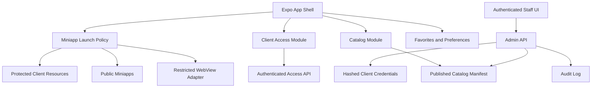

# CaboHealth Catalog Platform — Diseño de la versión para App Store

> **Histórico y no normativo:** no ejecutes tareas sin revalidarlas ni uses este archivo como estado actual. Quedaron sustituidos la topología permanente de dos proyectos, el acceso Apple mediante `reviewSandboxAdmin`/cuenta Staff y MFA/TOTP en producción. La autoridad vigente es [ADR 0001](../../decisions/0001-single-firebase-production-project.md), [ADR 0002](../../decisions/0002-password-only-staff-access.md), los runbooks de acceso, activación Firebase y contención Firestore, y los registros de activación fechados. Web público, overlay protegido y Staff password-only están desplegados; el puente/migración/lector estricto y el RC/TestFlight de Apple siguen pendientes.

**Fecha:** 2026-08-16

**Estado:** Aprobado por el usuario

**Alcance:** Aplicación iOS CaboHealth, catálogo remoto, acceso de clientes, panel administrativo y tres miniapps iniciales

## 1. Contexto

La aplicación actual es un launcher Expo/React Native que obtiene tarjetas desde Firestore y abre URLs en WebView. La revisión de Apple encontró fallos en miniapps existentes, acceso incompleto para Review y preguntas sobre datos, IA y contenido médico. La auditoría local también encontró reglas Firestore abiertas, secretos administrativos embebidos, rutas que evitan el control de acceso y una política WebView sin allowlist.

La versión nueva conserva el objetivo original: una plataforma vertical de CaboHealth donde el equipo pueda publicar miniapps fácilmente. La experiencia debe mostrar todas las miniapps disponibles de inmediato, permitir contenido público y contenido para clientes, mantener el panel administrativo y cumplir las condiciones aplicables de App Review Guidelines 2.1, 2.3.1, 3.1, 4.2, 4.7 y 5.1.

## 2. Decisiones aprobadas

1. La portada visual elegida es **A4**: fondo molecular animado, wordmark CaboHealth visible, tagline, frase central y botón principal.
2. En la primera instalación, la portada se muestra como introducción breve y continúa automáticamente al catálogo en un máximo de 1.8 segundos. El botón permite continuar inmediatamente.
3. Después de completar la introducción una vez, los lanzamientos posteriores abren directamente el catálogo. Settings ofrecerá “Ver introducción de nuevo”.
4. El catálogo muestra juntas las miniapps públicas y las miniapps para clientes.
5. Las miniapps públicas abren sin cuenta ni código.
6. Las miniapps para clientes permanecen visibles con nombre, descripción y candado. Un código de cliente desbloquea únicamente los módulos asignados.
7. Los códigos se entregan a pacientes o clientes existentes de CaboHealth y autentican una relación con servicios médicos presenciales consumidos fuera de la app; no tienen cargo digital separado, no se venden como licencias y no existe CTA de compra. Este modelo debe documentarse y pasar el gate 3.1 antes del envío; si no encaja inequívocamente, Client Resources será público o usará IAP.
8. App Review recibe una credencial estable, no expirable y capaz de abrir todas las funciones enviadas a revisión.
9. El panel administrativo se conserva, pero deja de depender de gestos secretos, PIN local o escritura Firestore anónima. Se protege mediante identidad de personal, MFA, rol administrativo y operaciones auditadas. Como Staff Sign In es visible, App Review recibe desde el inicio una cuenta no expirable en el mismo sistema Firebase Auth, con scope servidor `reviewSandbox` y acceso exclusivo a repositorios `review_sandbox_*`; nunca puede leer ni mutar recursos de producción.
10. Ninguna miniapp se activa silenciosamente después de la revisión. Cada incorporación material se documenta y se incluye en el proceso de release correspondiente.

## 3. Objetivos

- Mostrar un catálogo útil en un solo paso después de la introducción inicial.
- Dar valor público suficiente para que la aplicación no sea una colección de enlaces.
- Permitir acceso de clientes sin exponer secretos ni datos clínicos.
- Conservar una administración rápida del catálogo con controles reales de seguridad.
- Proteger toda navegación WebView con una política común.
- Entregar a Apple un build completo, verificable y con acceso permanente.
- Crear una base escalable para miniapps HTML5/JavaScript bajo un catálogo vertical de salud.

## 4. No objetivos de esta versión

- No incluir expedientes, análisis de sangre, protocolos individualizados ni datos de pacientes dentro de Service Hub.
- No incluir cámara, micrófono, escaneo cosmético, IA clínica o diagnóstico automatizado.
- No incluir calculadores de dosis, protocolos de péptidos ni recomendaciones de tratamiento.
- No publicar Sleep Lab, Gut Health, AI Cosmetic Scan, Health Advisor ni el Service Hub actual en el manifiesto de producción.
- No vender códigos, suscripciones ni funciones digitales fuera de In-App Purchase.
- No descargar ni ejecutar código nativo remoto ni exponer un puente JavaScript hacia APIs nativas.
- No usar feature flags para ocultar módulos a App Review y activarlos posteriormente.

## 5. Miniapps del lanzamiento inicial

### 5.1 Healthy Recipes — pública

Una miniapp de recetas saludables con:

- categorías y búsqueda;
- fichas con ingredientes, instrucciones, tiempo y porciones;
- favoritos guardados localmente;
- filtros alimentarios descriptivos, sin recomendaciones médicas personalizadas;
- información normal de seguridad alimentaria y alérgenos;
- contenido original de CaboHealth o contenido con licencia verificable.

No recopila datos de salud, no requiere cuenta y no afirma prevenir, diagnosticar o tratar enfermedades.

### 5.2 CaboHealth Clinic Guide — pública

Una miniapp informativa con:

- directorio de servicios en lenguaje neutral;
- ubicación, mapa, estacionamiento e idiomas disponibles;
- preparación práctica para una visita;
- botones externos de mapa, WhatsApp y correo;
- Privacy Policy, Terms, Support y fuentes cuando exista una afirmación médica.

No incluye formulario de evaluación médica ni recopila datos dentro de la miniapp.

### 5.3 Client Resources — para clientes

Una miniapp bloqueada, visible en el catálogo, que contiene únicamente recursos generales asignados a clientes existentes:

- materiales de orientación del programa;
- documentos generales sin datos personales;
- agenda y datos de contacto;
- recursos educativos revisados y con fuentes cuando corresponda.

El código de cliente desbloquea esta miniapp. No contiene PHI ni sustituye una cuenta clínica segura. El futuro Service Hub seguirá requiriendo autenticación individual y una especificación independiente.

### 5.4 Hosting y rutas

Las tres miniapps se sirven desde el dominio propio para mantener una relación de marca clara:

- `https://cabohealth.org/apps/healthy-recipes/`
- `https://cabohealth.org/apps/clinic-guide/`
- `https://cabohealth.org/apps/client-resources/`

Los builds web son artefactos estáticos separados del tema y se despliegan bajo `public_html/apps/` después de crear un respaldo verificable. WordPress conserva el sitio principal. Cada ruta tiene un universal link correspondiente y `/.well-known/apple-app-site-association` declara únicamente los paths de miniapps aprobados.

El bundle de Client Resources puede ser público, pero ningún contenido exclusivo se incluye en él. La miniapp envía por POST un launch nonce de un solo uso al broker CaboHealth; el nonce nunca aparece en URL/referrer. El broker crea una sesión web opaca y revocable y obtiene recursos autorizados desde un release privado fuera del docroot. El nonce expira en sesenta segundos y no puede reutilizarse.

## 6. Experiencia e información arquitectónica

### 6.1 Navegación principal

La navegación inferior mantiene tres destinos:

- **Apps:** catálogo completo, búsqueda y filtros;
- **Saved:** miniapps favoritas; los favoritos internos de recetas permanecen dentro de Healthy Recipes, sin puente JavaScript nativo;
- **Settings:** idioma, tema, biometría, reducir movimiento, soporte, privacidad, términos, cierre de sesión y acceso de personal.

El catálogo incluye filtros `All`, `Open` y `For clients`. Las tarjetas públicas muestran `Open`; las privadas muestran `Client` o `Secure`.

### 6.2 Portada y movimiento

- El wordmark se renderiza como imagen PNG de alta resolución, no como máscara CSS remota.
- La constelación conserva colores CaboHealth y limita su densidad según el área visible.
- La animación se detiene cuando la pantalla queda en background o fuera de vista.
- `Reduce Motion` elimina partículas, brillo y transiciones no esenciales.
- Los interiores usan movimiento solamente en encabezados compactos para reducir consumo y distracción.

### 6.3 Accesibilidad

- Todas las acciones tienen label, hint, role y estado accesible.
- Los candados anuncian “Requires CaboHealth client access”.
- El catálogo, búsqueda, filtros y formularios funcionan con VoiceOver.
- Los controles tienen un objetivo táctil mínimo de 44 × 44 puntos.
- El contenido admite Dynamic Type sin cortar nombres, códigos ni botones.
- El contraste cumple WCAG AA en texto normal y estados de error.

### 6.4 Idiomas

El shell, el catálogo y las miniapps iniciales se publican en inglés y español. Inglés es el fallback del build enviado a la tienda estadounidense; el usuario puede cambiar el idioma en Settings sin alterar su acceso. Ningún texto operativo, legal o de error queda embebido fuera del sistema de localización.

## 7. Arquitectura del sistema

### 7.1 App Shell

El shell nativo es responsable de navegación, presentación, accesibilidad, sesión, caché del catálogo y lanzamiento seguro. No conoce documentos Firestore crudos ni contiene credenciales maestras.

### 7.2 Catalog Module

Existe una sola instancia compartida del catálogo. Sus responsabilidades son:

- descargar el manifiesto publicado;
- validar y normalizar cada miniapp;
- combinar el snapshot remoto con una caché válida;
- exponer carga, actualización, offline y error;
- resolver una miniapp por ID o universal link;
- filtrar por acceso sin esconder tarjetas bloqueadas;
- invalidar favoritos de módulos retirados.

### 7.3 Client Access Module

El código se valida mediante una API de servidor. El cliente nunca consulta directamente la colección de códigos y nunca contiene un bypass maestro.

Access API se implementa con Firebase Cloud Functions v2, Firestore privado y App Check. Expone operaciones limitadas para redimir código, renovar sesión, consultar entitlements, crear launch nonce, revocar y eliminar la identidad técnica. No ofrece lectura genérica de códigos o clientes. El catálogo sanitizado se sirve aparte mediante HTTP GET público/cacheable para que el contenido público no dependa de App Attest.

La redención produce:

- un principal técnico Firebase pseudónimo y token de sesión de corta duración;
- una lista de entitlements permitidos;
- credenciales ID/refresh administradas por Firebase Auth nativo dentro de iOS Keychain, nunca leídas o serializadas por la app;
- nombre descriptivo opcional del programa, sin PHI.

El ID token dura aproximadamente sesenta minutos y cada operación vuelve a validar el grant. La credencial demo de App Review no expira durante Review pero sigue siendo revocable. El código original no se conserva. El servidor aplica normalización, HMAC versionado con pepper de Secret Manager, CSPRNG para nuevos códigos, expiración, revocación, rate limiting y auditoría. Cinco intentos fallidos dentro de quince minutos bloquean nuevos intentos durante quince minutos en ese dispositivo y origen.

Redimir un código no crea perfil, contraseña ni cuenta comercial, pero sí un principal técnico pseudónimo de Firebase. Settings ofrece `Remove Client Access`, que revoca grant, sesiones web y credenciales locales. También ofrece `Delete account and data`, que elimina el principal técnico y los datos deletables dentro de la app, y pseudonimiza únicamente auditoría sujeta a retención legal.

El acceso offline a contenido de cliente no se concede si la sesión nunca fue validada. Una sesión previamente válida puede usar caché no sensible durante un máximo de 24 horas; después requiere conexión. La revocación se aplica en la siguiente verificación y nunca se convierte en un bypass indefinido.

### 7.4 Miniapp Launch Policy

Antes de abrir una miniapp, una política única verifica:

- estado `published`;
- entitlement requerido;
- URL HTTPS;
- hostname incluido en `allowedHosts`;
- universal link válido;
- permisos y disclosures declarados;
- compatibilidad con la clasificación de edad del host.

El WebView:

- permite JavaScript necesario para HTML5;
- no ofrece un puente a APIs nativas;
- bloquea `javascript:`, `data:`, `file:` y hosts no autorizados;
- controla redirects y ventanas nuevas;
- muestra timeout, error HTTP, reintento y salida segura;
- solicita consentimiento antes de compartir cualquier dato o permiso con una miniapp;
- mantiene separados los contextos de cliente cuando sea necesario.

### 7.5 Administración

La interfaz administrativa conserva las funciones de alta, edición, orden, publicación y despublicación, pero opera mediante una API autenticada.

- La entrada aparece en Settings como `Staff Sign In`; no usa gesto oculto.
- El personal inicia sesión con Firebase Auth y MFA.
- Un custom claim `catalogAdmin` autoriza operaciones.
- La API vuelve a validar el rol en cada mutación.
- El cliente nunca escribe directamente el manifiesto publicado.
- Publicar requiere que URL, metadata, privacidad, permisos, edad y estado de revisión estén completos.
- Toda mutación registra actor, fecha, antes, después y motivo.
- No se almacenan PIN, master code ni claves administrativas en el bundle.

Admin API también se implementa con Cloud Functions v2. Las operaciones de catálogo y códigos usan transacciones o batches atómicos; una validación fallida no altera el manifiesto publicado.

## 8. Modelo de catálogo

Cada miniapp publicada contiene:

| Campo | Regla |
|---|---|
| `id` | Identificador estable e inmutable |
| `slug` | Segmento único para universal link |
| `displayName` | Nombre visible y localizado |
| `shortDescription` | Descripción neutral, máximo 140 caracteres |
| `icon` | Asset aprobado, HTTPS y con fallback local |
| `category` | Categoría vertical aprobada |
| `accessLevel` | `public`, `client` o `secureAccount` |
| `url` | URL HTTPS de lanzamiento |
| `universalLink` | Enlace público estable a la miniapp |
| `allowedHosts` | Hosts permitidos durante navegación |
| `privacyUrl` | Política aplicable a la miniapp |
| `reportUrl` | Canal visible para reportar contenido/problemas |
| `dataUse` | Datos recopilados, compartidos y finalidad |
| `permissions` | Cámara, micrófono, ubicación u otros; vacío en v1 |
| `ageRating` | Clasificación mínima del contenido |
| `status` | `draft`, `reviewReady`, `published` o `retired` |
| `version` | Versión de contenido declarada |
| `artifactHash` | SHA-256 del artefacto público/privado activado |
| `releaseBinding` | `releaseId` + versión/build de App Store congelados para ese hash; no incluye estado ni submission ID mutable |
| `editorialReviewedAt` | Fecha de última revisión editorial/clínica aplicable |
| `order` | Posición estable en catálogo |
| `updatedAt` | Timestamp de servidor |

Los documentos de catálogo público no contienen códigos, tokens, datos de pacientes ni secretos.

## 9. Flujos de datos

### 9.1 Abrir una miniapp pública

1. App Shell solicita la miniapp al Catalog Module.
2. Launch Policy valida estado, URL, host y metadata.
3. WebView abre la URL sin solicitar cuenta.
4. La app conserva únicamente favorito, última apertura y diagnóstico técnico no identificable.

### 9.2 Abrir una miniapp para clientes

1. La tarjeta permanece visible con candado.
2. Si no hay sesión válida, aparece `Client Access`.
3. El usuario introduce el código.
4. Access API valida hash, vigencia, rate limit y entitlements.
5. La app guarda tokens seguros, no el código.
6. Launch Policy muestra disclosure por módulo y solicita consentimiento explícito antes de compartir el identificador pseudónimo/entitlement.
7. Launch Policy solicita un nonce de un solo uso y lo envía por POST al broker.
8. El broker crea una cookie HttpOnly path-scoped ligada a una sesión web revocable; la API introspecta el grant con caché máxima de treinta segundos.
9. Un código revocado/expirado o Remove/Delete invalida sesión nativa y web y vuelve a mostrar el candado.

### 9.3 Publicar desde el panel

1. El administrador autenticado crea o edita un borrador.
2. El servidor valida esquema, HTTPS, allowlist, metadata, privacidad y permisos.
3. Una verificación automatizada comprueba disponibilidad y redirects.
4. El administrador marca el módulo `reviewReady` y añade notas de release.
5. Solo un módulo incluido en el candidate congelado y con `releaseBinding` exacto puede pasar a `published` para que App Review lo pruebe; restaurar una versión anterior exige una attestation aprobada.
6. La versión anterior queda registrada en Audit Log y puede restaurarse si el módulo falla.

## 10. Manejo de errores

| Condición | Comportamiento |
|---|---|
| Sin red y sin caché | Estado vacío con reintento; nunca concede acceso privado |
| Sin red con catálogo válido | Muestra catálogo cacheado y marca modo offline |
| Código incorrecto | Mensaje genérico; no revela existencia ni entitlement |
| Código expirado o revocado | Cierra sesión de cliente y ofrece contacto |
| Rate limit | Muestra tiempo de espera sin permitir nuevos intentos |
| Miniapp no disponible | Pantalla propia con Retry, Back y Support |
| Redirect no autorizado | Bloquea navegación y registra diagnóstico |
| HTTP 4xx/5xx o timeout | Detiene spinner y muestra error accionable |
| Documento de catálogo inválido | Omite el documento inválido y conserva el último manifiesto válido; un manifiesto válido con subconjunto aprobado sí aplica como kill switch |
| Error administrativo parcial | La mutación es atómica; no publica estados intermedios |

## 11. Privacidad y seguridad

- Firestore niega toda escritura anónima.
- La lectura pública se limita al manifiesto publicado sin secretos.
- Códigos y tokens se almacenan hashed o cifrados; los logs nunca muestran su valor.
- App Check protege APIs móviles cuando la plataforma lo permita.
- Todos los endpoints aplican TLS y validación de origen.
- No se registra contenido de WebView, recetas guardadas, consultas de búsqueda ni datos clínicos.
- Privacy Policy explica el shell, cada miniapp y cualquier proveedor externo.
- El usuario ve un disclosure antes de compartir datos o conceder permisos a una miniapp.
- La versión inicial no solicita cámara, micrófono, fotos, contactos ni ubicación precisa.
- El futuro contenido con PHI requiere autenticación individual, autorización por usuario, cifrado, auditoría y una revisión de privacidad separada.

## 12. Cumplimiento de App Review

El envío incluye:

1. explicación de que CaboHealth es un host vertical y curado de miniapps HTML5/JavaScript;
2. tabla de cada miniapp con acceso, URL, universal link, datos, permisos, edad y monetización;
3. código demo no expirable que abre todas las funciones enviadas;
4. credenciales secundarias cuando una miniapp las requiera;
5. pasos exactos desde una instalación limpia;
6. confirmación de que no se descarga código nativo ni se exponen APIs nativas;
7. explicación de que los códigos autentican clientes existentes y no se venden como licencias digitales;
8. backend activo durante toda la revisión y contacto disponible;
9. notas específicas para cada función nueva o cambio material.

El índice completo y las tarjetas bloqueadas permanecen visibles durante Review. No se usan nombres genéricos, enlaces rotos, estados ficticios ni módulos inactivos.

## 13. Pruebas y criterios de aceptación

### 13.1 Funcionalidad

- Instalación limpia muestra A4, continúa en ≤1.8 segundos y permite continuar al tocar el botón.
- Segundo lanzamiento abre directamente el catálogo.
- Healthy Recipes y Clinic Guide abren sin código.
- Las tarjetas para clientes siempre son visibles.
- Código demo abre todas las funciones revisables y no expira.
- Código inválido, expirado, revocado y rate-limited produce el estado correcto.
- Logout elimina tokens, caché privada, timestamps de sesión y entitlements.
- Delete account and data elimina el principal técnico, grant y sesiones web y entrega confirmación dentro de la app.
- Deep links hacia módulos privados respetan el mismo gate de acceso.
- Favorites se actualiza inmediatamente en todas las pantallas.

### 13.2 Seguridad

- Firebase Emulator Rules demuestra que usuarios anónimos no pueden escribir.
- Usuarios sin rol no pueden crear, modificar, publicar ni borrar miniapps.
- El bundle no contiene master code, PIN ni credenciales administrativas.
- Launch Policy bloquea hosts y esquemas no autorizados, redirects externos y popups.
- Offline nunca transforma un error de red en acceso concedido.
- Los intentos de enumeración y fuerza bruta activan rate limiting.

### 13.3 Calidad web y contenido

- Todas las URLs, universal links, Privacy, Terms, Support y contacto responden correctamente.
- Un link checker recorre cada ruta pública y cada ruta de demo autorizada.
- No hay errores JavaScript no controlados en Safari móvil ni WebView.
- Las miniapps funcionan en viewport de iPhone, orientación vertical y Dynamic Type.
- Recetas muestran alérgenos y seguridad alimentaria sin claims terapéuticos.
- Cualquier afirmación médica restante tiene una fuente primaria próxima y visible.

### 13.4 Accesibilidad y rendimiento

- Flujo completo navegable con VoiceOver.
- Reduce Motion elimina animación no esencial.
- Contraste, targets táctiles y tamaños de texto cumplen los criterios definidos.
- La portada no mantiene animación en background.
- El catálogo interactivo aparece en ≤2 segundos con conexión normal y ofrece caché inmediata en lanzamientos posteriores.

### 13.5 Build y App Store

- TypeScript, lint, tests unitarios, tests de reglas y E2E terminan sin fallos.
- El build release exacto se instala desde TestFlight en un iPhone físico.
- Se recorren instalación limpia, actualización, background, offline y deep links.
- Version, build number, icono sin alfa, screenshots y metadata coinciden con el binario.
- App Privacy, age rating, Review Notes y demo credentials están completos.
- No se carga a App Store Connect hasta que el checklist del build exacto esté firmado.

## 14. Estrategia de implementación y despliegue

El trabajo se divide en entregas verificables:

1. **Base segura:** modelo de dominio, Catalog Module, Access Module, reglas Firestore, API y pruebas.
2. **Shell visual:** portada A4, catálogo, estados de acceso, Settings y accesibilidad.
3. **Miniapps públicas:** Healthy Recipes y Clinic Guide con hosting, universal links y link checks.
4. **Client Resources:** acceso protegido, launch token, contenido no sensible y demo de Review.
5. **Administración:** Staff Sign In, rol, CRUD validado, auditoría y release gate.
6. **Hardening:** WebView, deep links, offline, caché, rate limits, privacidad y pruebas E2E.
7. **Release:** deploy web/backend, TestFlight, pruebas del build exacto, metadata, carga y envío a Review.

Antes de modificar WordPress se crea un respaldo verificable. Los despliegues web y backend se realizan antes del build iOS para que las URLs incluidas estén estables. El manifiesto/catálogo inmutable guarda sólo `releaseId`, versión/build y hashes. Una `ReviewAttestation` privada del servidor agrega eventos append-only `candidate → submitted → approved` con submission ID; añadir esos eventos nunca cambia los bytes públicos. El catálogo puede retirar un módulo roto, pero sólo restaura hashes con attestation aprobada; cualquier cambio material incluso bajo el mismo slug crea otro candidate/release/revisión.

## 15. Resultado esperado

La versión enviada a Apple es una plataforma CaboHealth coherente y útil: ofrece recetas y guía clínica públicas, presenta recursos de clientes de forma transparente, protege el acceso mediante servidor, conserva administración segura y entrega a Review acceso completo. La arquitectura deja espacio para futuras miniapps sin convertir la aplicación en un marketplace general ni depender de funciones ocultas.
